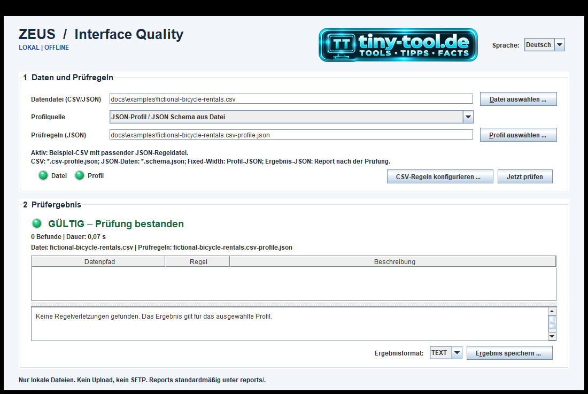
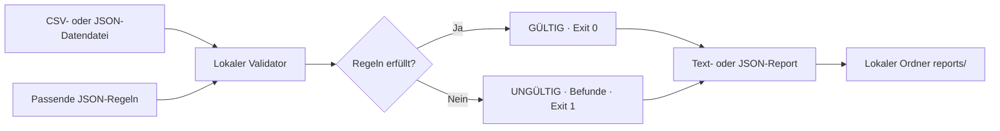
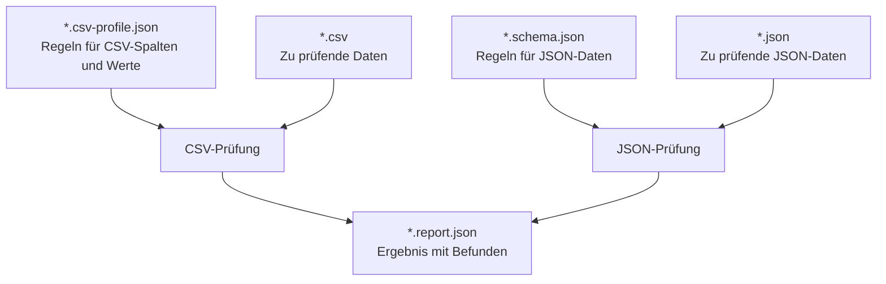
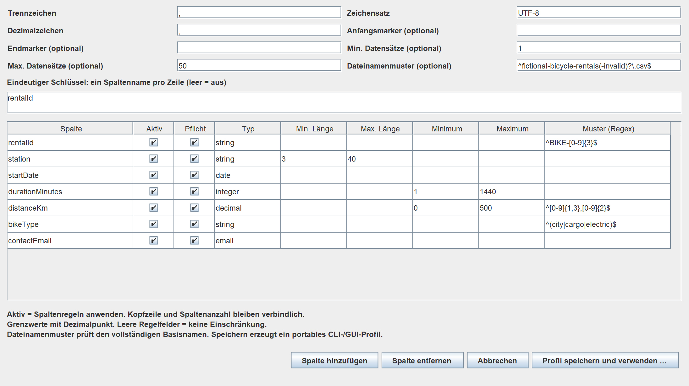

<p align="center"><a href="https://tiny-tool.de/"></a></p>

# ZEUS Interface Quality

**Schnittstellendaten lokal prüfen, Befunde nachvollziehen und Reports speichern.**

[Deutsch](README.de.md) · [English](README.md) · [Beispiele](docs/examples/README.de.md) · [Changelog](CHANGELOG.md) · [Apache 2.0](LICENSE)

Java 21 · Desktop-GUI und headless CLI · CSV, JSON und Fixed-Width · HTTP/SFTP über CLI

Dieselben JSON-Regeln funktionieren in der Desktop-Anwendung und in automatisierten
Abläufen. Mit den Beispieldaten aus unserem Testlabor lässt sich sofort ein
erfolgreicher und ein fehlerhafter Prüflauf ausprobieren.

## Aktueller Stand

Entwicklungsstand: **0.1.0-SNAPSHOT**, Dokumentation vom **20.10.2026**.
Dies ist keine Aussage über eine Produktionsfreigabe oder Zertifizierung.

| Funktion | Desktop-GUI | CLI |
|---|---|---|
| Lokales JSON Schema Draft 2020-12 | Ja | Ja |
| CSV / Fixed-Width prüfen | Ja | Ja |
| Fahrradverleih-Beispiel aus dem Testlabor mit Profil | Ja, vorausgewählt | `--profile` |
| Lokales CSV-Profilbeispiel | Ja, vorausgewählt | `--profile` |
| Visueller CSV-Regeleditor | Ja | Profil-JSON exportieren/bearbeiten |
| LED-Status, Befunde und Details | Ja | Text-/JSON-Report |
| Reports als UTF-8-JSON / Text speichern | Ja | `--report-file` |
| HTTP-/SFTP-Adapter | Gesperrt | Verfügbar; mit `--local-only` gesperrt |

## Einblick in die Anwendung

Nach `.\mvnw.cmd -B package` die GUI mit
`java -jar .\target\zeus-interface-quality-0.1.0-SNAPSHOT.jar gui` starten.
Der erste Screenshot zeigt das vorausgewählte Beispiel nach **Jetzt prüfen**.
Der zweite zeigt die [absichtlich fehlerhafte CSV](docs/examples/fictional-bicycle-rentals-invalid.csv)
mit **derselben JSON-Regeldatei**.

| Gültiges Beispiel | Fehlerhaftes Beispiel |
|---|---|
| [](docs/images/gui-valid-de.png) | [](docs/images/gui-invalid-de.png) |

Die Ansichten für gültige und fehlerhafte Daten wurden im GUI-Test aus der
laufenden Swing-Anwendung aufgenommen. Die CSV-Regelansichten sind 2×-
Renderings des Swing-Dialogs und zeigen seine Profileinstellungen.
Ein Klick öffnet die volle Auflösung. Die GUI-Sprache steuert Befunde der
CSV-, Fixed-Width- und JSON-Schema-Prüfungen. Die CLI bietet dieselbe
Sprachauswahl über `--language`.

### Prüfdetails

Nach Auswahl eines Befunds zeigt die Detailansicht die vollständige Meldung,
den Datenpfad, den Profilpfad und die angewendete Regel. Die Ansicht bleibt
unabhängig vom gewählten lokalen JSON Schema oder CSV-Profil.

[](docs/images/gui-invalid-de.png)

Das aktuelle funktionierende Beispiel bleibt bewusst lokal und vollständig
reproduzierbar: die mitgelieferte Fahrradverleih-CSV auswählen, mit dem
passenden Profil prüfen, bei Bedarf die Oberflächensprache wechseln und
denselben Report als JSON oder Text speichern. Der begleitende
[Artikel zu Iteration 7: Desktop-GUI und lokale Prüfung](https://tiny-tool.de/schnittstellen-testen-iteration-7-gui/)
führt durch den erfolgreichen ersten Lauf und das absichtlich fehlerhafte
Beispiel.

### Ablauf einer Prüfung



### Aufgabe der JSON-Dateien



Die vorhandene SFTP-Erweiterung unterstützt außerdem die deterministische
Verzeichnisauswahl (Profil v2) und korrelierte Lieferungen mit Claim-, Recovery-
und Archivschritten (Profil v3). Siehe [SFTP-Vertrag v2](docs/contracts/sftp-profile-v2.md)
und [SFTP-Vertrag v3](docs/contracts/sftp-profile-v3.md). Diese CLI-Funktionen
gehören nicht zum lokalen GUI-Ablauf.

Lokale Eingabedateien, eigene Regeldateien und erzeugte Reports in den von Git
ignorierten Ordnern `data/` und `reports/` halten. Die GUI prüft nur lokale Dateien; für
Offline-Abläufe der CLI `--local-only` verwenden. Ohne diesen Schalter können
HTTP-/SFTP-Befehle konfigurierte Endpunkte kontaktieren. Transporttests gehören
auf eine lokale Testinstanz.

## Voraussetzungen und Build

- JDK **21 oder neuer** im `PATH`; Swing gehört zum JDK.
- Maven wird vom eingecheckten Maven Wrapper bereitgestellt.
- Netzwerk nur für den ersten Maven-/Abhängigkeitsdownload erforderlich,
  nicht für spätere lokale Prüfungen. Kein Browser, Webserver, Node.js oder
  zusätzliches GUI-Paket notwendig.
- Archive separat entpacken; bei vorhandenen CSVs ist 7-Zip nicht erforderlich.

Windows PowerShell, im Repository-Hauptverzeichnis:

```powershell
.\mvnw.cmd -B package
```

Der Befehl führt die Tests aus und erzeugt das ausführbare JAR samt
Abhängigkeiten: `target\zeus-interface-quality-0.1.0-SNAPSHOT.jar`.
`test` allein erzeugt dieses JAR **nicht**. Nach Änderungen am Code oder
mitgelieferten Profil neu bauen.

Weitere Builds sind nach dem Laden der Abhängigkeiten offline möglich:

```powershell
.\mvnw.cmd -B dependency:go-offline
.\mvnw.cmd -o -B package
```

Unter macOS/Linux das eingecheckte Skript `mvnw` verwenden.
Die folgenden Beispiele nutzen **Windows PowerShell**. Bash-Zeilenfortsetzung
mit `\`, Command-Prompt-Fortsetzung mit `^` und PowerShell-Syntax nicht mischen.

## Desktop: interaktiv prüfen

Doppelklick auf [start-gui.cmd](start-gui.cmd) oder nach dem Build:

```powershell
java -jar .\target\zeus-interface-quality-0.1.0-SNAPSHOT.jar gui
```

Der Starter baut ein fehlendes JAR ohne Testausführung für den ersten Start.
Ein vorhandenes JAR wird nicht neu gebaut; der Starter ersetzt keinen
vollständigen getesteten Build.

Unter Linux oder macOS die GUI aus einer grafischen Sitzung mit folgendem
Starter öffnen:

```sh
./start-gui.sh
```

Der POSIX-Starter prüft JDK 21 oder neuer, baut ein fehlendes JAR mit dem Maven
Wrapper und reicht zusätzliche Argumente an die GUI weiter. Er benötigt eine
verfügbare grafische Anzeige; auf Servern ohne Anzeige die headless CLI nutzen.

1. Beim Start sind die Fahrradverleih-Beispiel-CSV und das passende
   JSON-Profil bereits eingetragen. Mit **Jetzt prüfen** direkt testen.
2. Für andere lokale CSV-, JSON- oder Fixed-Width-Dateien Datendatei und
   zugehörige JSON-Regeldatei auswählen. Für das mitgelieferte Beispiel ist das
   passende CSV-Profil bereits vorausgewählt; eigene Profile lassen sich öffnen.
   Die GUI lädt jedes ausgewählte lokale JSON Schema bzw. Profil dynamisch.
3. Optional **CSV-Regeln konfigurieren** öffnen. Das Speichern legt ein
   bearbeitbares JSON-Profil standardmäßig unter `data/` an; das bestehende
   Beispielprofil wird dabei nicht überschrieben.
4. **Jetzt prüfen** oder **Strg+Enter**: Die Prüfung läuft im Hintergrund.
   Eingabe-/Profilwechsel sind während des Vorgangs deaktiviert.
5. Einen Befund auswählen: komplette Meldung, Datenpfad, Profilpfad und Regel
   werden im Detailbereich angezeigt.
6. TEXT oder JSON wählen und **Ergebnis speichern** anklicken. Der Dialog
   beginnt im ignorierten lokalen Ordner `reports/`.

Die JSON-Datei neben der Beispiel-CSV ist ein **Regelprofil**: Sie legt
Spalten, Typen und Prüfungen für genau diese CSV fest. Ein JSON Schema wie
[`delivery.schema.json`](docs/examples/delivery.schema.json) enthält dagegen
Regeln für eine JSON-Datendatei. Ein unter `reports/` gespeichertes JSON ist
das **Ergebnis** einer Prüfung und keine oben auszuwählende Regeldatei.

Über **Sprache** im Kopfbereich lässt sich zwischen Deutsch und Englisch
wechseln, ohne das aktuelle Prüfergebnis zu verlieren. Bei der nächsten
Prüfung steuert die Auswahl die Meldungen für CSV, Fixed-Width und JSON Schema.
Das TT-Banner öffnet [tiny-tool.de](https://tiny-tool.de/) im Standardbrowser.

| LED | Bedeutung |
|---|---|
| Grau | Kein aktuelles Prüfergebnis |
| Gelb | Prüfung läuft |
| Grün | Gültig gegen das ausgewählte Profil |
| Rot | Ungültige Daten oder technischer Fehler, durch Klartext unterschieden |

Die kleinen Datei-/Profil-LEDs zeigen **nur die Dateiexistenz**, keine
Inhaltsgültigkeit. Farbe wird durch Text ergänzt. Eingabe-/Profilwechsel
verwerfen das vorherige Ergebnis und deaktivieren dessen Reportexport.
Eingabe und Profil sind gegen Überschreiben durch Reports geschützt,
einschließlich vorhandener Dateialiasse. Das Ersetzen anderer Reports erfordert
in der GUI eine Bestätigung. Ohne grafischen Desktop meldet `gui` einen Fehler
und endet mit Exitcode `2`.

## Einmal konfigurieren, in beiden Oberflächen verwenden

Der CSV-Regeleditor bietet Zeichensatz, Trenn-/Dezimalzeichen, BOF/EOF-Marker,
Datensatzgrenzen und einen zusammengesetzten Eindeutigkeitsschlüssel.
Je Spalte sind Name, Aktiv-/Pflichtschalter, Typ, Zeichenlängen, numerische
Grenzen und Regex bearbeitbar. Spaltendefinitionen lassen sich hinzufügen
oder entfernen, um das Layout anzupassen.

Typen: `string`, `integer`, `decimal`, `email`, `date`, `time`.
Deaktivierte Wertregeln entfernen die Spalte nicht und umgehen weder Kopfzeile,
Spaltenanzahl noch einen expliziten Eindeutigkeitsschlüssel.
Fehlerhafte Konfigurationen werden auch bei deaktivierten Spalten abgelehnt.

### CSV-Regeln konfigurieren

Der Dialog **CSV-Regeln konfigurieren** macht die Profildefinition sichtbar und
bearbeitbar: Trenn- und Dezimalzeichen, Zeichensatz, BOF-/EOF-Marker,
Datensatzgrenzen, Dateinamenmuster, Eindeutigkeitsschlüssel und Regeln je
Spalte. Das optionale Dateinamenmuster prüft den vollständigen Basisnamen in
GUI und CLI. So lässt sich ein CSV-Layout nachvollziehbar anpassen, bevor das
Profil gespeichert und für die Prüfung verwendet wird.

Die optionale **Korrektur** ist standardmäßig ausgeschaltet. Ist sie aktiv,
fragt die GUI vor einer Änderung der Eingabedatei nach. Entfernt werden können
Datensätze mit zeilenbezogenen Befunden, sofern die vorbereitete CSV danach die
Prüfung besteht. Nach erfolgreicher Korrektur bleibt das Original als
`<datei>.original.bak` erhalten; entfernte Datensätze samt Kopfzeile stehen in
`<datei>.rejected.csv`, und `<datei>.correction.json` protokolliert Zeilen und
Befunde. Vorhandene Belege werden nicht ersetzt. Details und Grenzen stehen im
[CSV-Profilvertrag](docs/contracts/csv-profile-v1.de.md).

[](docs/images/gui-csv-rules-de.png)

Ein bearbeitbares Profil in der GUI speichern oder eine eigene JSON-Profildatei
unter `data/` ablegen und danach mit `--profile .\data\team-profile.json`
automatisiert verwenden.
Der [CSV-Profilvertrag](docs/contracts/csv-profile-v1.de.md) beschreibt Defaults,
Leerwerte, Genauigkeitsmuster und Eindeutigkeit anhand exakter Zeichenfolgen.
JSON Schema und Fixed-Width bleiben ebenfalls als lokale Profile nutzbar;
der visuelle Regeleditor ist speziell für CSV.

## CLI und Build-Pipelines

Die CLI öffnet kein Fenster und funktioniert auf headless Build-Agents:

```powershell
java '-Djava.awt.headless=true' -jar .\target\zeus-interface-quality-0.1.0-SNAPSHOT.jar validate --profile .\docs\examples\fictional-bicycle-rentals.csv-profile.json --input .\docs\examples\fictional-bicycle-rentals.csv --local-only --report json
```

Dieses [CSV-/Profilpaar aus dem Testlabor](docs/examples/README.de.md#csv-beispiel-aus-dem-testlabor)
liefert `VALID` und Exit `0`. Für Befunde und einen lokalen Report wird die
fehlerhafte CSV mit denselben Regeln geprüft:

```powershell
New-Item -ItemType Directory -Force .\reports | Out-Null
java '-Djava.awt.headless=true' -jar .\target\zeus-interface-quality-0.1.0-SNAPSHOT.jar validate --profile .\docs\examples\fictional-bicycle-rentals.csv-profile.json --input .\docs\examples\fictional-bicycle-rentals-invalid.csv --local-only --report json --report-file .\reports\fictional-bicycle-rentals-invalid.report.json
$LASTEXITCODE  # 1: Prüfung mit Befunden abgeschlossen
```

Die Datei enthält fünf Befunde: Mindestwert, ungültiges Datum, doppelte Miet-ID,
nicht erlaubter Fahrradtyp und ungültige E-Mail-Adresse. Unter
`reports/fictional-bicycle-rentals-invalid.report.json` stehen zu jedem Befund
Datenpfad, Regelpfad und Meldung. Der Report bleibt lokal im Projekt.

Eigenständiges JSON-Beispiel mit eingecheckten Beispieldaten aus dem Testlabor:

```powershell
java -jar .\target\zeus-interface-quality-0.1.0-SNAPSHOT.jar validate --profile .\src\test\resources\fixtures\delivery.schema.json --input .\src\test\resources\fixtures\valid-delivery.json --local-only --report json
```

| Option / Befehl | Verhalten |
|---|---|
| `validate --profile PATH` / `--schema PATH` | Lokales Profil/JSON Schema; genau eine Profilquelle erforderlich |
| `--input PATH` | Für lokale Formate erforderlich; bei SFTP nicht verwendet |
| `--input-format` | `auto` (Default), `json`, `csv`, `fixed-width`, `http`, `sftp`; explizite Auswahl übersteuert Erkennung |
| `--local-only` | Sperrt HTTP-/SFTP-Formate und -Profile vor Transportzugriff |
| `--report text\|json` | stdout-Format; Default TEXT |
| `--report-file PATH` | Zusätzlich derselbe Report als UTF-8; Zielverzeichnis muss existieren |
| `--language de/en` | Sprache der Befunde; Standard ist Deutsch (`de`) |
| `gui`, `--help`, `validate --help` | Desktop-Einstieg / Befehlshilfe |

Die Argumentverarbeitung ist nicht-interaktiv; Fehler führen nicht zu Rückfragen.

| Exitcode | Bedeutung |
|---|---|
| `0` | Prüfung erfolgreich |
| `1` | Prüfung abgeschlossen, Regelverletzungen gefunden |
| `2` | Betriebs-, Konfigurations- oder Befehlsfehler |

Reports gehen nach stdout, operative Diagnosen nach stderr. Die Reportdatei
darf weder Eingabe noch Profil ersetzen; andere vorhandene Reports werden
ersetzt. Schreibfehler liefern `2`, ohne einen erfolgreichen Prüfreport auf
stdout auszugeben. Bei einem Betriebsfehler kann eine alte Reportdatei
erhalten bleiben: **immer den Exitcode auswerten**, nicht nur die Dateiexistenz.
Der stabile [Reportvertrag](docs/contracts/validation-report-v1.de.md) behält
dieselbe Befundstruktur. Eine erfolgreiche CSV-Korrektur ergänzt optionale
Zusammenfassungsmetadaten. Mit `--language de` oder `--language en` lässt sich
die unterstützte Befundsprache wählen. Für Automatisierung Status, Pfade und
Regelkennungen statt des lokalisierten Meldungstexts verwenden.

Bei CSV-Profilen steuert `correction.enabled`, ob die CLI fehlerhafte
Datensätze entfernt. Standard ist `false`; die CLI fragt nicht nach einer
Bestätigung. Nur in Profilen aktivieren, die ihre Eingabedatei ändern dürfen.
Belege und Grenzen sind im [CSV-Profilvertrag](docs/contracts/csv-profile-v1.de.md)
beschrieben. Transportbefunde für SFTP und HTTP behalten ihre jeweiligen
Adaptermeldungen.

Lokales PowerShell-Pipeline-Skript, Abbruch beim ersten Ergebnis ungleich null:

```powershell
.\mvnw.cmd -o -B package
if ($LASTEXITCODE -ne 0) { exit $LASTEXITCODE }
$jar = '.\target\zeus-interface-quality-0.1.0-SNAPSHOT.jar'
$files = @(
  '.\data\first.csv',
  '.\data\second.csv'
)
foreach ($file in $files) {
  $report = Join-Path '.\target' ((Get-Item -LiteralPath $file).BaseName + '.report.json')
  java '-Djava.awt.headless=true' -jar $jar validate --profile '.\data\rules.csv-profile.json' --input $file --local-only --report json --report-file $report
  if ($LASTEXITCODE -ne 0) { exit $LASTEXITCODE }
}
exit 0
```

Mehrere Dateien werden mit getrennten CLI-Aufrufen geprüft; es gibt keinen
integrierten Batch- oder Mehrdateivergleichsbefehl. Die Platzhalterdateien
durch eigene CSVs und die passende Regeldatei ersetzen. `exit` ist für ein
Pipeline-Skript gedacht.

## Weitere Adapter und Grenzen

- JSON: genau ein Dokument; doppelte Schlüssel, nachfolgende Inhalte und
  fehlerhaftes JSON/Schema sind Betriebsfehler. Draft-2020-12-Metaprüfung,
  Schemareferenzen nur auf reguläre Dateien innerhalb des Wurzelschemaordners;
  entfernte Referenzen werden abgelehnt.
- Fixed-Width: einsbasierte Zeichenpositionen, Satzlänge und skalare Regeln;
  leere Dateien sind ungültig. `sourceLanguage` dokumentiert die Herkunft,
  aktiviert aber keinen Quelltextparser.
- [HTTP-Vertrag](docs/contracts/http-profile-v1.de.md): optionale JSON-
  Anfrageprüfung, erwarteter Status/Header und JSON-Antwort; keine Redirects.
- [SFTP-Vertrag](docs/contracts/sftp-profile-v1.de.md): eine stabile Datei,
  strikte Hostkeys, Schlüsselanmeldung, optionaler Hash und explizite
  Quarantäne. Die Verträge [v2](docs/contracts/sftp-profile-v2.md) und
  [v3](docs/contracts/sftp-profile-v3.md) beschreiben Verzeichnisauswahl und
  korrelierte Lieferungen.
- FTP, XML, YAML-spezifische Syntax und allgemeine Mehrdatei-Fachregeln sind
  nicht implementiert. Die CLI ist keine Sandbox für feindliche oder
  gleichzeitig veränderte Dateien.

## Dokumentation und Entwicklung

- [English guide](README.md), [zweisprachiges Changelog](CHANGELOG.md)
- CSV-Vertrag: [Deutsch](docs/contracts/csv-profile-v1.de.md) / [English](docs/contracts/csv-profile-v1.md)
- Beispiele: [Deutsch](docs/examples/README.de.md) / [English](docs/examples/README.md)
- Reportvertrag: [Deutsch](docs/contracts/validation-report-v1.de.md) / [English](docs/contracts/validation-report-v1.md)
- [Entscheidungen](docs/decisions/) und [Iterationen](docs/iterations/) bleiben
  historische Aufzeichnungen. Dortige Funktionsgrenzen und Testzahlen beziehen
  sich auf den jeweiligen damaligen Stand.

Ein Maven-Modul, Java-21-Bytecodeziel, Jackson, NetworkNT, Commons CSV, Picocli,
JSch und JUnit/AssertJ; Apache MINA SSHD stellt einen lokalen SFTP-Testserver.
Abhängigkeitsversionen stehen in [pom.xml](pom.xml). Kein Spring Boot.
Headless Builds überspringen grafische Smoke-Tests, nicht Validator-/CLI-Tests.
Tests verwenden Beispieldaten oder lokale Testendpunkte, kein produktives SFTP.

## Fehlerbehebung

- **Alte GUI oder fehlende Änderungen:** mit `.\mvnw.cmd -B package` neu bauen;
  der Starter verwendet ein vorhandenes JAR weiter.
- **JAR nicht gefunden:** `package` statt nur `test` im Repository-Hauptordner starten.
- **Archiv ausgewählt:** entpackte CSV statt `.7z`/`.zip` auswählen.
- **JVM-Optionsfehler in PowerShell:** `'-Djava.awt.headless=true'` gequotet lassen.
- **SLF4J-Providerwarnung:** der paketierte JSON-Validator kann
  `No SLF4J providers were found` auf stderr melden. Diese Warnung allein ist
  kein Validierungsfehler; Report auf stdout und Prozess-Exitcode auswerten.
- **Leerer Report oder alte Datei:** stderr und Exitcode `2` prüfen; Zielordner
  muss existieren und die Ausgabe darf weder Eingabe noch Profil sein.

## Lizenz

Copyright 2026 [tiny-tool.de](https://tiny-tool.de/). Das Projekt steht unter
der [Apache License, Version 2.0](LICENSE); siehe [NOTICE](NOTICE).
Abhängigkeiten behalten ihre jeweiligen Lizenzen und Herkunftshinweise.
