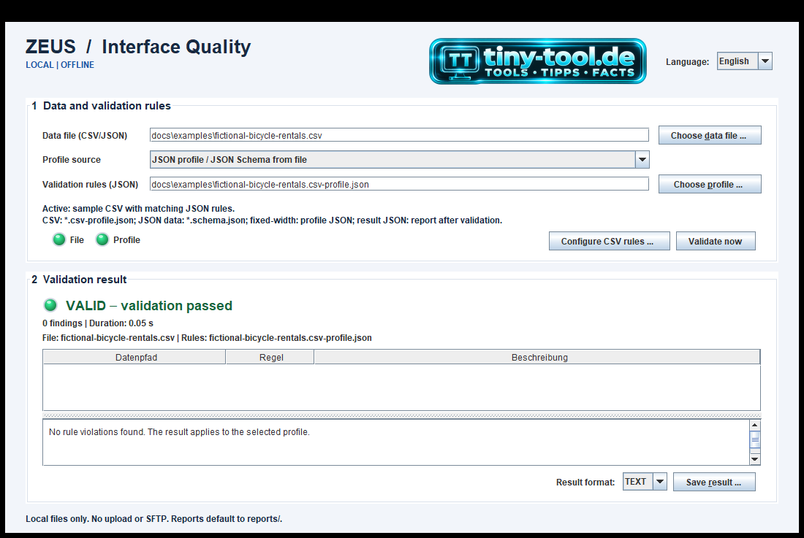
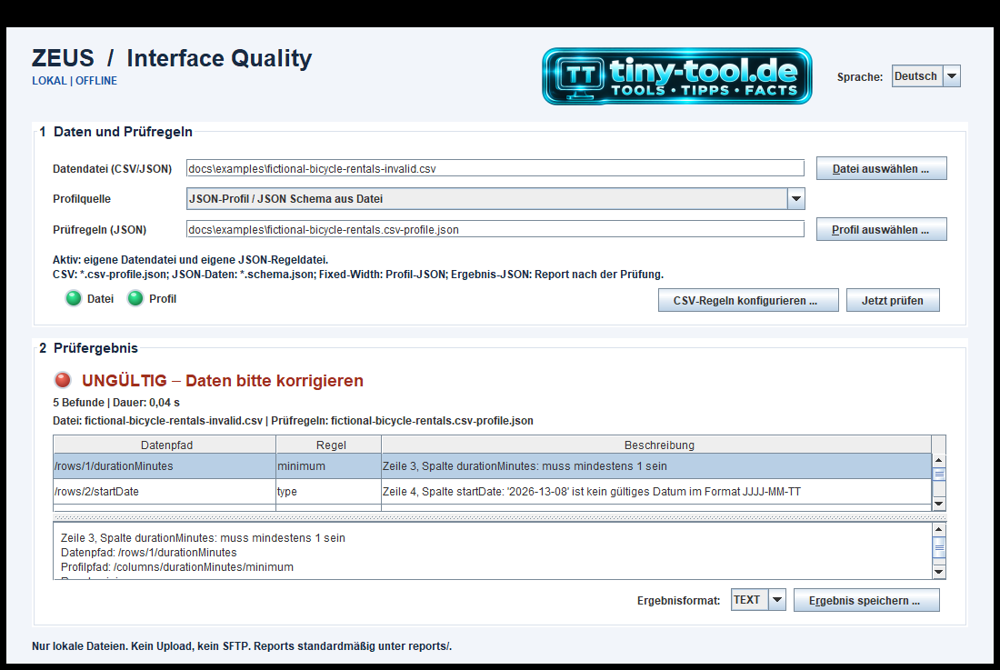
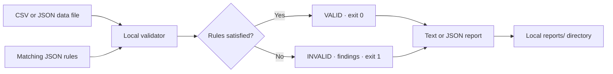
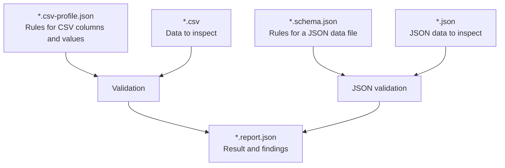
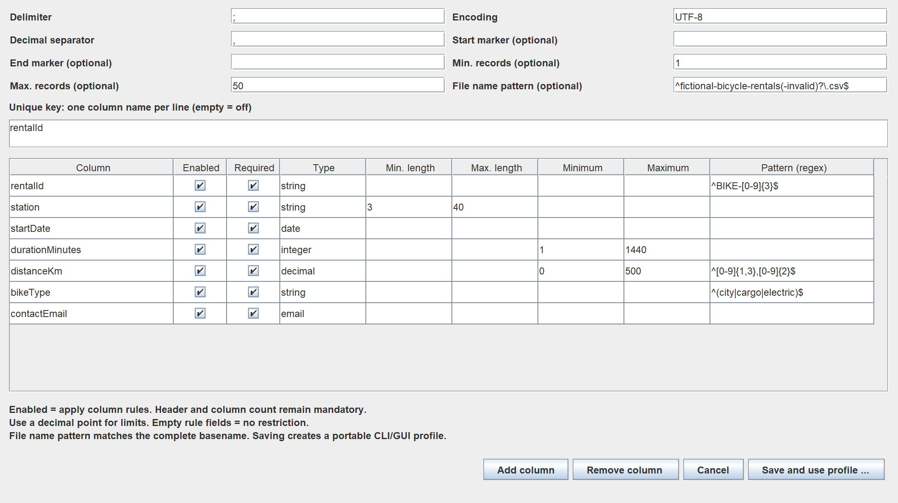

<p align="center"><a href="https://tiny-tool.de/"></a></p>

# ZEUS Interface Quality

**Validate interface data locally, see every finding, and export a reproducible report.**

[English](README.md) · [Deutsch](README.de.md) · [Examples](docs/examples/README.md) · [Changelog](CHANGELOG.md) · [Apache 2.0](LICENSE)

Java 21 · Desktop GUI and headless CLI · CSV, JSON and fixed-width files · HTTP/SFTP via CLI

The same JSON rules work in the desktop application and in automated runs.
The ready-to-use bicycle-rental example comes from our test lab; you can try
a successful check and a failing check without preparing any files.

## Current status

Development snapshot: **0.1.0-SNAPSHOT**, documentation updated **2026-10-23**.
This is not a production-release or certification claim.

| Capability | Desktop GUI | CLI |
|---|---|---|
| Local JSON Schema Draft 2020-12 | Yes | Yes |
| CSV / fixed-width validation | Yes | Yes |
| Bicycle-rental example from the test lab with profile | Yes, selected by default | `--profile` |
| Local CSV profile example | Yes, selected by default | `--profile` |
| Visual CSV rule editor | Yes | Export/edit profile JSON |
| LED status, findings and details | Yes | Text / JSON report |
| Save reports as UTF-8 JSON / text | Yes | `--report-file` |
| HTTP / SFTP adapters | Blocked | Available; blocked by `--local-only` |

## See it in action

Run `.\mvnw.cmd -B package`, then `java -jar .\target\zeus-interface-quality-0.1.0-SNAPSHOT.jar gui`.
The first screenshot shows the default example after **Validate now**; the
second shows the [deliberately invalid CSV](docs/examples/fictional-bicycle-rentals-invalid.csv)
checked with the **same JSON profile**.

| Valid example | Invalid example |
|---|---|
| [](docs/images/gui-valid-en.png) | [](docs/images/gui-invalid-de.png) |

The valid and invalid views were captured from the running Swing application by
the GUI test. The CSV editor views are 2× renders of the Swing dialog and show
its profile settings. Click either image for full resolution. The GUI language
controls findings for CSV, fixed-width and JSON Schema validation. The CLI
accepts the same language choice with `--language`.

### Validation details

After selecting a finding, the detail view shows the complete message, data
path, profile path, and applied rule. The view remains generic and works with
any selected local JSON Schema or CSV profile.

[](docs/images/gui-invalid-de.png)

The current working example is deliberately local and self-contained: select
the bundled bicycle-rental CSV, validate it with its matching profile, switch
the interface language if desired, and export the same result as JSON or text.
The companion article [Iteration 7: desktop GUI and local validation](https://tiny-tool.de/interface-testing-iteration-7-desktop-gui/)
walks through that successful first run and the deliberately invalid example.

### Validation flow



### What each JSON file does



The existing SFTP work covers an exact remote file (v1), bounded polling of a
remote directory with exactly one matching regular file (v2), and a correlated
delivery with an optional companion file (v3). V4 supports a required companion
file with its own content format, profile, and optional SHA-256. V3 adds delivery identity,
atomic claim and recovery, success archiving, and lifecycle metadata in the
report. All versions verify a stable remote snapshot, can compare SHA-256,
download into a temporary directory, and delegate content checks to JSON, CSV,
or fixed-width validation. See the [v2 contract](docs/contracts/sftp-profile-v2.md)
and [v3 contract](docs/contracts/sftp-profile-v3.md). These CLI features remain
outside the local GUI workflow.
An interrupted v3 claim can resume when its matching file is still incoming;
incomplete or ambiguous deliveries are left untouched and reported as invalid.
See the [v4 contract](docs/contracts/sftp-profile-v4.md) for mixed-format
deliveries.

Keep local input files, rule files and generated reports in the Git-ignored
`data/` and `reports/` directories. The GUI validates local files only; use
`--local-only` for offline CLI runs. Without that flag, HTTP/SFTP commands can
contact configured endpoints. Transport tests should use a local test instance.

## Requirements and build

- JDK **21 or newer** on `PATH`; Swing is included in the JDK.
- The checked-in Maven Wrapper supplies Maven; no separate Maven installation.
- Network access is needed for initial Maven/dependency downloads, not for
  subsequent local validation. No browser, webserver, Node.js or GUI package.
- Archives must be extracted separately; 7-Zip is optional if CSVs are available.

Windows PowerShell, from the repository root:

```powershell
.\mvnw.cmd -B package
```

This runs tests and produces the executable, dependency-bundled
`target\zeus-interface-quality-0.1.0-SNAPSHOT.jar`. `test` alone does **not**
produce that JAR. Rebuild after changing code or the bundled profile.

For subsequent offline builds, after dependencies have been cached:

```powershell
.\mvnw.cmd -B dependency:go-offline
.\mvnw.cmd -o -B package
```

On macOS/Linux use the checked-in `mvnw` script instead. Command examples below
use **Windows PowerShell** paths and syntax; do not mix Bash `\` continuation,
Command Prompt `^` continuation and PowerShell syntax.

## Desktop: interactive validation

Double-click [start-gui.cmd](start-gui.cmd), or after building run:

```powershell
java -jar .\target\zeus-interface-quality-0.1.0-SNAPSHOT.jar gui
```

The launcher builds a missing JAR with tests skipped for startup. It does not
rebuild an existing JAR or replace a full tested build.

On Linux or macOS, start the same GUI from a graphical session with:

```sh
./start-gui.sh
```

The POSIX launcher checks for JDK 21 or newer, builds a missing JAR with the
Maven Wrapper, and passes additional arguments to the GUI. It requires an
available desktop display; use the headless CLI on servers without a display.

1. The bicycle-rental example CSV and its matching JSON profile are selected
   when the GUI opens. Click **Validate now** to try them immediately.
2. To check another local CSV, JSON or fixed-width file, choose a data file and
   its JSON rule file. The supplied CSV profile is selected by default for the
   bundled example; choose another local profile when needed.
   The GUI loads each selected local JSON Schema or profile dynamically.
3. Optionally open **Configure CSV rules**. Saving creates an editable
   JSON profile under `data/` by default; the example profile is not
   overwritten.
4. Click **Validate now** or press **Ctrl+Enter**. Validation runs in the
   background. Input/profile changes are disabled until the operation finishes.
5. Select a finding to see the full message, data path, profile path and rule.
6. Choose TEXT or JSON and click **Save result**. The chooser starts in
   the ignored local `reports/` directory.

The JSON file beside the example CSV is a **rule profile**: it defines columns,
types and checks for that CSV. A JSON Schema such as
[`delivery.schema.json`](docs/examples/delivery.schema.json) instead defines
rules for a JSON data file. A JSON file saved under `reports/` is the **result**
of a completed validation, never the rule file to select above.

Use the **Language** selector in the header to switch between English and
German without losing the current result. The TT banner opens
[tiny-tool.de](https://tiny-tool.de/) in the system's default browser.
The selected GUI language controls CSV, fixed-width and JSON Schema findings
on the next validation run.

| LED | Meaning |
|---|---|
| Grey | No current validation result |
| Amber | Validation running |
| Green | Valid against the selected profile |
| Red | Invalid data or operational error, distinguished by text |

Small input/profile LEDs indicate **file existence only**, not content validity.
Color is supplemented by text. Changing input/profile clears the previous
result and disables its report export. Saving reports protects input/profile
files (including existing aliases); replacing another report requires GUI
confirmation. No graphical desktop: `gui` reports an error and exits with `2`.

## Configure once, use in both interfaces

The visual CSV editor supports encoding, delimiter, decimal separator,
BOF/EOF markers, row-count bounds and a composite uniqueness key. For each
column, edit its name, enabled/required switches, type, string lengths, numeric
bounds and regex. Add/remove column definitions to match the layout.

Supported value types: `string`, `integer`, `decimal`, `email`, `date`, `time`.
Disabling a column's value rules does not remove the column or bypass the
header, column-count or explicit uniqueness checks. Invalid configurations
are rejected, including disabled columns with invalid rules.

### Configure CSV rules

The **Configure CSV rules** dialog makes the profile definition visible and
editable: delimiter and decimal separator, encoding, BOF/EOF markers, row
limits, filename pattern, uniqueness key, and the rules for each column. The
optional filename pattern checks the complete basename in both GUI and CLI.
This makes it easy to adapt an existing CSV layout before saving and using the
profile for validation.

The optional **Correction** setting is off by default. When enabled, the GUI
asks before changing the input file. It can remove invalid data records only
when findings point to data rows and the staged CSV passes validation. After a
successful correction, the original is retained as `<file>.original.bak`,
removed records (including the header) go to `<file>.rejected.csv`, and
`<file>.correction.json` records row references and findings. Existing
artifacts are never replaced. See the [CSV profile contract](docs/contracts/csv-profile-v1.md)
for limits and details; the [correction regression coverage](docs/iterations/iteration-10-csv-correction-verification.md)
describes the automated checks.

[](docs/images/gui-csv-rules-en.png)

Save an editable profile from the GUI, or copy a local JSON profile into `data/`.
Then use `--profile .\data\team-profile.json` for automation.
The [CSV profile contract](docs/contracts/csv-profile-v1.md) defines all defaults,
empty-value handling, precision patterns and exact-string uniqueness.
JSON Schema and fixed-width profiles can also be supplied as local files;
the visual rule editor is specifically for CSV.

## CLI and build pipelines

The CLI starts no window and works on headless build agents:

```powershell
java '-Djava.awt.headless=true' -jar .\target\zeus-interface-quality-0.1.0-SNAPSHOT.jar validate --profile .\docs\examples\fictional-bicycle-rentals.csv-profile.json --input .\docs\examples\fictional-bicycle-rentals.csv --local-only --report json
```

This [CSV and profile pair from the test lab](docs/examples/README.md#csv-example-from-the-test-lab)
returns `VALID` and exit `0`. To see findings and create a local report, run
the invalid example with the same rules:

```powershell
New-Item -ItemType Directory -Force .\reports | Out-Null
java '-Djava.awt.headless=true' -jar .\target\zeus-interface-quality-0.1.0-SNAPSHOT.jar validate --profile .\docs\examples\fictional-bicycle-rentals.csv-profile.json --input .\docs\examples\fictional-bicycle-rentals-invalid.csv --local-only --report json --report-file .\reports\fictional-bicycle-rentals-invalid.report.json
$LASTEXITCODE  # 1: validation completed with findings
```

The file contains five findings: a minimum violation, an invalid date, a
duplicate rental ID, an unsupported bike type and an invalid email. Inspect
`reports/fictional-bicycle-rentals-invalid.report.json` for the data path,
rule path and message of each finding. The report stays in the local project.

The [valid JSON sample](docs/examples/delivery.json) and its deliberately
[invalid counterpart](docs/examples/delivery-invalid.json) use the same local
[JSON Schema](docs/examples/delivery.schema.json):

```powershell
java '-Djava.awt.headless=true' -jar .\target\zeus-interface-quality-0.1.0-SNAPSHOT.jar validate --profile .\docs\examples\delivery.schema.json --input .\docs\examples\delivery.json --local-only --report json
$LASTEXITCODE  # 0: VALID
java '-Djava.awt.headless=true' -jar .\target\zeus-interface-quality-0.1.0-SNAPSHOT.jar validate --profile .\docs\examples\delivery.schema.json --input .\docs\examples\delivery-invalid.json --local-only --report json
$LASTEXITCODE  # 1: INVALID
```

| Option / command | Behavior |
|---|---|
| `validate --profile PATH` / `--schema PATH` | Local profile or JSON Schema; exactly one profile source is required |
| `--input PATH` | Required for local formats; not used for SFTP |
| `--input-dir DIR --glob PATTERN` | Validate matching regular files directly in one directory, in filename order; default pattern is `*` |
| `--recursive` | Include matching files in subdirectories of `--input-dir`; reports keep their relative paths |
| `--input-format` | `auto` (default), `json`, `csv`, `fixed-width`, `http`, `sftp`; explicit choice overrides detection |
| `--local-only` | Rejects HTTP/SFTP formats and profiles before transport access |
| `--report text\|json\|sarif` | stdout format; default TEXT; SARIF 2.1.0 is for CI code scanning |
| `--report-file PATH` | Also writes the same report as UTF-8; parent directory must exist |
| `--language de/en` | Finding language; defaults to German (`de`) |
| `gui`, `--help`, `validate --help` | Desktop entry point / command help |

Arguments are non-interactive: configuration/file errors never prompt for user
input.

| Exit code | Meaning |
|---|---|
| `0` | Validation succeeded |
| `1` | Validation completed with rule violations |
| `2` | Operational/configuration/command error |

Text/JSON/SARIF reports go to stdout; operational diagnostics go to stderr.
Report-file writes protect input/profile and replace other existing reports.
Write errors return `2` without printing a successful validation report.
On an operational failure an old report may remain: **always check the exit
code**, not just the existence of a report file.
The stable [report contract](docs/contracts/validation-report-v1.md) keeps the
same finding shape. CSV correction adds optional summary metadata after a
successful correction. Use `--language de` or `--language en` to select
supported finding languages; automation should use status, paths and rule
keywords rather than localized wording. SFTP/HTTP transport-level findings
retain their adapter messages.

For CSV profiles, `correction.enabled` controls row removal in the CLI and is
disabled by default. The CLI does not prompt; enable it only in a profile
intended to modify its input file. The original backup and audit artifacts are
described in the [CSV profile contract](docs/contracts/csv-profile-v1.md).
Use `--dry-run-correction` to validate proposed removals in temporary files
and report eligible rows without changing inputs or creating sidecars. It works
for single-file and batch CSV validation.

Batch validation checks matching files and emits one aggregate JSON, text, or
SARIF report. By default, it checks one directory level; add `--recursive` to
include subdirectories. Files are processed by relative path, and a per-file
operational error does not prevent later files from being checked:

```powershell
.\mvnw.cmd -o -B package
if ($LASTEXITCODE -ne 0) { exit $LASTEXITCODE }
$jar = '.\target\zeus-interface-quality-0.1.0-SNAPSHOT.jar'
java '-Djava.awt.headless=true' -jar $jar validate --profile '.\data\rules.csv-profile.json' --input-dir '.\data\incoming' --glob '*.csv' --local-only --report json --report-file '.\target\batch.report.json'
exit $LASTEXITCODE
```

Batch reports use `zeus-validation-batch-v1` and contain one result per file,
including its `relativePath`. SARIF batches combine findings into one run and
point each result to its source file.
Batch discovery skips symbolic links, including linked files that could point
outside the selected input directory. Correction previews report existing
sidecars in `blockedBy` and mark the proposal as ineligible.
Exit `0` means all files are valid, `1` means at least one file is invalid,
and `2` means at least one file had an operational error or the batch could not
start. `--input-dir` accepts local formats only; it does not compare records
across files. `--dry-run-correction` keeps row-removal previews read-only during
batch runs.

## Additional adapters and boundaries

- JSON: exactly one document; duplicate keys, trailing content and malformed
  input/schema are operational errors. Draft 2020-12 meta-validation and schema
  references restricted to regular files inside the root schema directory;
  remote references rejected.
- Fixed-width: one-based character positions, record length and scalar rules;
  empty input is invalid. `sourceLanguage` documents origin, not a source parser.
- [HTTP](docs/contracts/http-profile-v1.md): optional JSON request validation,
  expected status/headers and JSON response validation; no redirects.
- [SFTP](docs/contracts/sftp-profile-v1.md): one stable file, strict host keys,
  key authentication, optional hash and opt-in quarantine. The
  [v2](docs/contracts/sftp-profile-v2.md) and
  [v3](docs/contracts/sftp-profile-v3.md) contracts cover directory selection
  and correlated delivery lifecycle. [v4](docs/contracts/sftp-profile-v4.md)
  adds per-file validation profiles and companion digest checks.
- FTP, XML, YAML-specific syntax and general multi-file business rules are not
  implemented. The CLI is not a sandbox for hostile or concurrently modified files.

## Documentation and development

- [German guide](README.de.md), [bilingual changelog](CHANGELOG.md)
- CSV contract: [English](docs/contracts/csv-profile-v1.md) / [German](docs/contracts/csv-profile-v1.de.md)
- Examples: [English](docs/examples/README.md) / [German](docs/examples/README.de.md)
- Report contract: [English](docs/contracts/validation-report-v1.md) / [German](docs/contracts/validation-report-v1.de.md)
- Batch report contract: [English](docs/contracts/validation-batch-v1.md) / [German](docs/contracts/validation-batch-v1.de.md)
- [Release checklist](docs/release-checklist.md)
- Current iterations: [recursive batches](docs/iterations/iteration-14-recursive-batches.md), [batch correction preview](docs/iterations/iteration-15-batch-correction-preview.md), [SARIF batches](docs/iterations/iteration-16-batch-sarif.md), [correction and batch safety](docs/iterations/iteration-17-correction-and-batch-safety.md), [crash recovery and release readiness](docs/iterations/iteration-18-crash-safe-correction-and-release-readiness.md), [SFTP partial claim recovery](docs/iterations/iteration-19-sftp-partial-claim-recovery.md), [SFTP v4 mixed-format delivery](docs/iterations/iteration-20-sftp-v4-mixed-format-delivery.md), [JSON Schema showcase](docs/iterations/iteration-21-json-schema-showcase.md)
- [Design decisions](docs/decisions/) and [iterations](docs/iterations/) are
  historical records; their scope statements and test counts describe those
  iterations, not the current feature set.

One Maven module, Java 21 bytecode target, Jackson, NetworkNT, Commons CSV,
Picocli, JSch and JUnit/AssertJ; Apache MINA SSHD supplies a local SFTP test
server. See [pom.xml](pom.xml) for dependency versions. No Spring Boot.
Headless builds skip graphical smoke tests, not the local validator/CLI tests.
Tests use sample fixtures or local test endpoints, not production SFTP.

## Troubleshooting

- **Old GUI or missing changes:** rebuild with `.\mvnw.cmd -B package`; the
  launcher reuses an existing JAR.
- **Cannot find the JAR:** run `package`, not only `test`, from the repository root.
- **Archive selected:** choose the extracted CSV, not `.7z`/`.zip`.
- **PowerShell JVM option error:** keep `'-Djava.awt.headless=true'` quoted.
- **SLF4J provider warning:** the packaged JSON validator can print
  `No SLF4J providers were found` to stderr. This warning alone is not a
  validation failure; use the report on stdout and the process exit code.
- **Unexpectedly empty report or old file:** inspect stderr and exit code `2`;
  verify that the target directory exists and input/profile are not the target.

## License and authorship

Copyright 2026 [tiny-tool.de](https://tiny-tool.de/). The project is licensed
under the [Apache License, Version 2.0](LICENSE); see [NOTICE](NOTICE).
Dependencies retain their own licenses and attribution notices.
